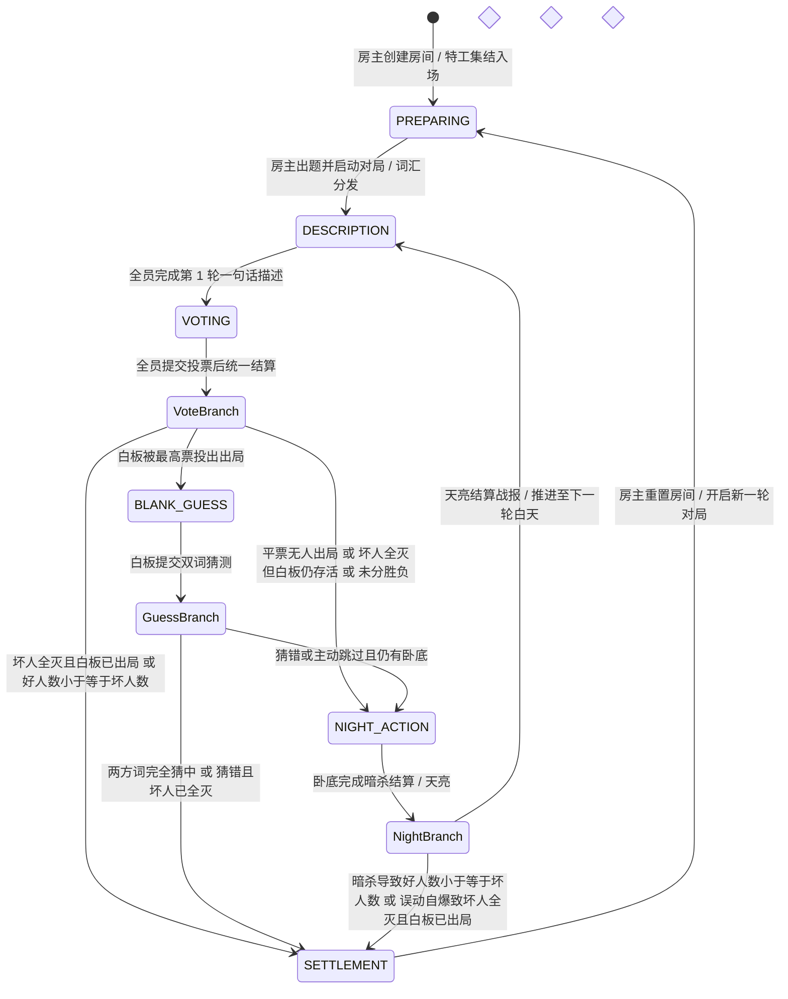
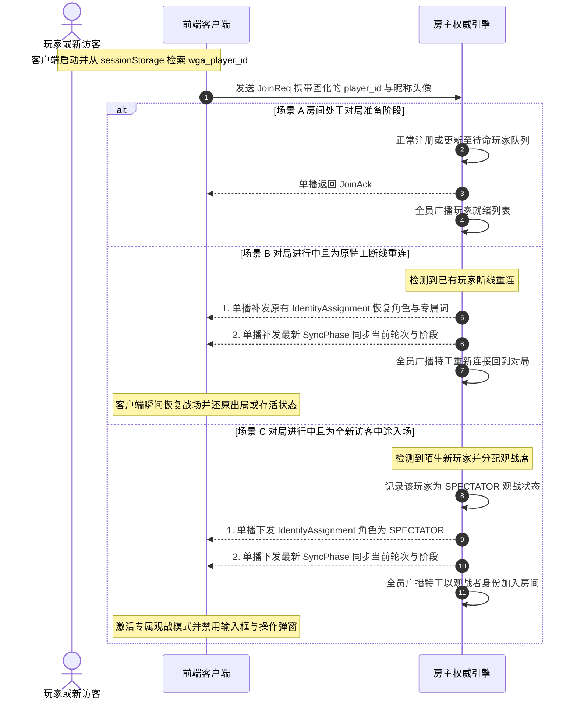
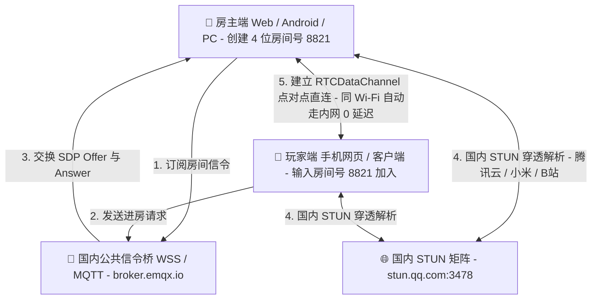
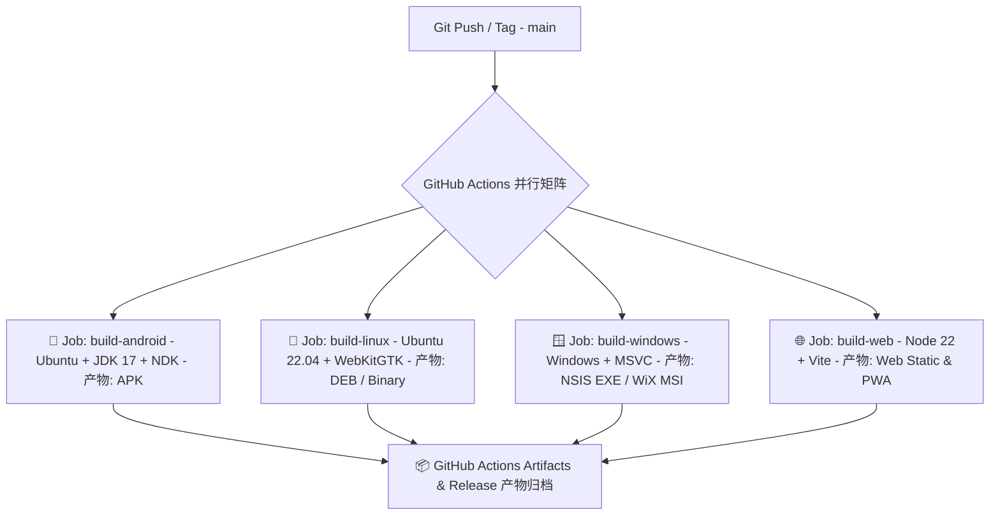

# 🕵️ Word Guess Assistant (卧底猜词助手)

> **基于 Tauri 2.0 + WebRTC P2P + Tokio + Google Protobuf + Vue 3 + Tailwind CSS 4 + DaisyUI 5 构建的全平台（Web / Android / Windows / Linux）去中心化多人在屏猜词博弈应用。**

---

## 📖 目录

- [一、项目简介与核心亮点](#一项目简介与核心亮点)
- [二、技术选型与分层架构](#二技术选型与分层架构)
- [三、核心游戏规则详述](#三核心游戏规则详述)
  - [1. 四大秘境身份与阵营机制](#1-四大秘境身份与阵营机制)
  - [2. 4 ~ 12 人动态身份分配对照表](#2-4--12-人动态身份分配对照表)
  - [3. 终局胜负判定准则](#3-终局胜负判定准则)
  - [4. 发词盲盒与特工推测便签系统](#4-发词盲盒与特工推测便签系统)
  - [5. 智能双层词库引擎](#5-智能双层词库引擎)
- [四、完整游戏流程与状态推进](#四完整游戏流程与状态推进)
  - [1. 全局博弈阶段状态机](#1-全局博弈阶段状态机)
  - [2. 详细阶段流转与控制规则](#2-详细阶段流转与控制规则)
  - [3. 历史线索回溯与全员阶段确认](#3-历史线索回溯与全员阶段确认)
- [五、断线重连与中途观战状态机设计](#五断线重连与中途观战状态机设计)
  - [1. 核心状态交互时序图](#1-核心状态交互时序图)
  - [2. 断线重连状态无感恢复机制](#2-断线重连状态无感恢复机制)
  - [3. 陌生访客中途加入与观战者状态](#3-陌生访客中途加入与观战者状态)
  - [4. 对局终了重置与观战者转正](#4-对局终了重置与观战者转正)
- [六、双模网络架构与通信协议](#六双模网络架构与通信协议)
  - [1. WebRTC P2P 全平台互联与国内高可用穿透矩阵](#1-webrtc-p2p-全平台互联与国内高可用穿透矩阵)
  - [2. Listen-Server 虚拟信箱回环设计](#2-listen-server-虚拟信箱回环设计)
  - [3. 帧安全编解码协议](#3-帧安全编解码协议)
  - [4. 局域网自动探针广播与组播服务发现 (mDNS / SSDP)](#4-局域网自动探针广播与组播服务发现-mdns--ssdp)
- [七、项目工程目录结构](#七项目工程目录结构)
- [八、全平台编译构建与部署指南 (Android / Linux / Windows / Web)](#八全平台编译构建与部署指南-android--linux--windows--web)
  - [1. 编译环境依赖全景总览](#1-编译环境依赖全景总览)
  - [2. Android 平台编译与打包流程 (APK / AAB)](#2-android-平台编译与打包流程-apk--aab)
  - [3. Linux 原生平台构建与分发 (DEB / AppImage / Binary)](#3-linux-原生平台构建与分发-deb--appimage--binary)
  - [4. Windows 原生平台构建与打包 (NSIS EXE / WiX MSI / Portable)](#4-windows-原生平台构建与打包-nsis-exe--wix-msi--portable)
  - [5. Web 纯网页端编译与容器化部署 (Static / PWA / Docker)](#5-web-纯网页端编译与容器化部署-static--pwa--docker)
  - [6. GitHub Actions 全平台自动化持续集成流水线 (CI/CD)](#6-github-actions-全平台自动化持续集成流水线-cicd)
  - [7. 本地联调、单元测试与多特工虚拟对决](#7-本地联调单元测试与多特工虚拟对决)
- [九、未来演进规划](#九未来演进规划)

---

## 一、项目简介与核心亮点

**Word Guess Assistant** 是一款专为朋友聚会、团队破冰及硬核推理爱好者设计的全平台去中心化在屏猜词博弈工具。

### 🌟 核心亮点

1. **全平台 WebRTC P2P + 离线局域网 TCP/IP 双模互联**：
   - **P2P 极简房间号（主推模式）**：纯静态网页（如 GitHub Pages）、Android 手机、Windows 与 Linux 客户端零门槛跨端互联。房主一键生成 4 位房间号，好友输入房间号即可秒进；同一 Wi-Fi 局域网下自动匹配内网 IP 直连（0 延迟 0 丢包），无需部署任何私有后端服务器。
   - **国内高可用 STUN / WSS 穿透矩阵**：内置腾讯云、小米、哔哩哔哩国内低延迟 STUN 节点与国内直连公共信令通道，并支持自定义节点配置，彻底解决海外节点访问受阻问题。
   - **离线原生 Listen-Server 兜底**：在完全断网的纯内网环境下，原生客户端可展开「离线局域网 IP 直连」面板，通过 TCP 端口监听与 UDP SSDP 自动探针广播实现离线组局。
2. **极速强劲原生底座**：原生端采用 Rust (Tauri 2.0 + Tokio) 构建网络层与状态机，内存占用低于 30MB，高频并发通信毫秒级延迟。
3. **高密度二进制与数据通道协议**：原生传输层采用 Google Protocol Buffers 3 配合 4 字节小端序长度前缀编解码（Length-Prefixed Framing）杜绝 TCP 粘包与半包；WebRTC 端采用 `RTCDataChannel` 可靠有序点对点传输。
4. **精美现代移动交互**：前端基于 Vue 3 + DaisyUI 5 打造，采用手机黄金比例（390×844）紧凑视口，内置 15 款专属矢量特工头像矩阵与高对比度主题系统。
5. **严密公平的博弈机制**：发词阶段全员阵营盲盒、私密单选投票、白板双词逆袭、黑夜刺杀与误动自爆、断线重连保护与中途观战席位，提供专业面杀体验。

---

## 二、技术选型与分层架构

| 模块分层 | 技术选型 | 版本 / 核心技术 | 选用原因与职责 |
| :--- | :--- | :--- | :--- |
| **跨端宿主底座** | Tauri 2.0 | `2.12.x` (Desktop & Mobile) | 统一构建 Windows、Linux 与 Android 原生安装包，极小体积与低内存消耗 |
| **全平台互联层** | WebRTC + MQTT over WSS | `RTCPeerConnection` + `RTCDataChannel` | 支持纯静态网页与全平台客户端通过 4 位房间号点对点直连，同 Wi-Fi 自动走内网 |
| **国内穿透矩阵** | 国内公共 STUN / WSS | 腾讯 `stun.qq.com` / 小米 / B站 | 提供中国大陆低延迟 NAT 穿透解析与免运维信令握手 |
| **离线异步底座** | Tokio + Socket2 | `tokio 1.x` + `socket2 0.6` | 支撑无外网环境下的原生 TCP 长连接并发与 UDP 组播房间发现 |
| **二进制编解码** | Prost + Protobuf 3 | `prost 0.13` + `tokio-util` | 强类型契约通信、4 字节小端序帧长度前缀及 1MB 防超额攻击防护 |
| **前端视图框架** | Vue 3 + TypeScript | `Vue 3.5` + `TS 5.7` | 响应式状态总线、双模博弈引擎与严格静态类型保障 |
| **样式与设计系统** | Tailwind CSS 4 + DaisyUI 5 | `@tailwindcss/vite 4.3` + `daisyui 5.7` | 极速原子化 CSS、聊天气泡流与模态对话框交互 |

---

## 三、核心游戏规则详述

游戏支持 **4～12 名玩家** 动态组局对决。底层引擎根据实际进房人数动态调配阵营天平，确保信息不对称博弈的对抗张力。

### 1. 四大秘境身份与阵营机制

#### 🛡️ 好人阵营 (Good)

- **持词机制**：获知多数派词（好词）。
- **盲盒机制**：发词阶段身份卡统一显示为「特工」，**不显示好人角标**。玩家必须结合全员发言与逻辑推导，自行判断自己是属于多数派（好词）还是少数派（坏词）。
- **行动权限**：仅在首日白天提交一句话描述发言；白天拥有公投表决权；**夜间禁止动刀**（若擅自行动将导致自身意外身亡自爆）。

#### 🕵️ 卧底阵营 (Spy)

- **持词机制**：获知少数派词（坏词）。
- **盲盒机制**：发词阶段身份卡同样显示为「特工」，**不显示卧底角标**。卧底需在发言过程中敏锐察觉自己与大多数人词意的偏差，迅速调整伪装思路。
- **暗杀特权**：夜晚暗杀阶段，卧底拥有暗杀刺杀特权。可选择暗杀一名特工，或选择本夜静默不刀。

#### 👼 天使 (Angel)

- **阵营归属**：归属好人阵营，是好人阵营的信息中枢与引路人。
- **双词机制**：**天使在发词阶段同时获知好词与坏词两个词语（显示顺序随机，天使未知哪个好哪个坏）**。
- **使命与策略**：天使需倾听全场发言，推断出多数派使用的词与卧底使用的词，在不暴露自身天使身份（避免被卧底夜间锁定狙杀）的前提下，引导好人阵营将卧底公投出局。

#### 🎭 白板 (Blank)

- **持词机制**：**不持有任何词汇**。系统仅为其提供一句模糊的相似方向提示（Hint）。全程依赖察言观色、逻辑捕捉他人描述并展开无痕伪装。
- **双重特殊法则**：
  1. **黑夜暗杀如常出局（不触发猜词）**：白板在夜间若被卧底刺杀，像普通玩家一样正常出局（OUT），静默计入夜间伤亡，**不会**触发白天专属的猜词特别阶段；
  2. **白天被投触发双词逆袭（专属猜词阶段）**：当白板在白天讨论被公投出局时，游戏将在进入夜晚前立即插入专属「白板猜词（`BLANK_GUESS`）」特别阶段。若白板能**同时准确猜出两方的具体词汇（好词与坏词）**，白板将直接凌驾于好人与卧底之上，**独立夺取本局游戏胜利**！若未完全猜中或放弃，游戏则如常推进至夜间暗杀阶段。

---

### 2. 4 ~ 12 人动态身份分配对照表

为保证对局的紧凑感与白板逆袭机制的唯一性，在 4~12 人局中，**白板角色严格锁定为 1 名**，**天使角色严格锁定为 1 名**：

| 总人数 | 🕵️ 卧底 (Spy) | 👼 天使 (Angel) | 🎭 白板 (Blank) | 🛡️ 平民好人 (Good) | 好人阵营总计 (Good + Angel) | 比例与博弈格局说明 |
| :---: | :---: | :---: | :---: | :---: | :---: | :--- |
| **4 人** | 1 | 1 | 1 | 1 | 2 | 迷你经典四人局 (1卧 : 2好 : 1白) |
| **5 人** | 1 | 1 | 1 | 2 | 3 | 标准五人进阶局 (1卧 : 3好 : 1白) |
| **6 人** | 2 | 1 | 1 | 2 | 3 | 六人双卧风云局 (2卧 : 3好 : 1白) |
| **7 人** | 2 | 1 | 1 | 3 | 4 | 七人双卧稳健局 (2卧 : 4好 : 1白) |
| **8 人** | 2 | 1 | 1 | 4 | 5 | 八人双卧大局 (2卧 : 5好 : 1白) |
| **9 人** | 3 | 1 | 1 | 4 | 5 | 九人三卧乱斗局 (3卧 : 5好 : 1白) |
| **10 人** | 3 | 1 | 1 | 5 | 6 | 十人三卧平衡局 (3卧 : 6好 : 1白) |
| **11 人** | 3 | 1 | 1 | 6 | 7 | 十一人大局博弈 (3卧 : 7好 : 1白) |
| **12 人** | 4 | 1 | 1 | 6 | 7 | 十二人四卧巅峰局 (4卧 : 7好 : 1白) |

---

### 3. 终局胜负判定准则

游戏引擎在每个阶段的裁决点均会自动进行三方胜负判定：

1. **✨ 白板独立获胜**：
   - 白板特工在白天被投票放逐后，在 `BLANK_GUESS` 专属阶段中，准确猜出双方词汇（`guess_good == word_good && guess_spy == word_spy`，顺序支持容错校验），游戏立即终止，宣告白板阵营获胜。
2. **🛡️ 好人阵营获胜**：
   - **双重核心前提**：场上所有卧底（`alive_spies == 0`）全部被投票放逐出局或因夜间盲动自爆出局，**且白板被找出并猜词失败**（若对局存在白板，白板必须已出局且未猜词成功独立获胜）。
   - **潜伏反制机制**：若所有卧底已全灭，但白板依然存活在场上伪装潜伏（尚未被公投找出），好人阵营**无法**直接获胜，对局必须继续推进！好人必须在后续轮次中将白板公投出局；若白板猜词失败，好人阵营方可正式锁定胜利。
3. **🕵️ 卧底阵营获胜**：
   - 场上存活的好人总数（存活平民好人 + 存活天使，即 `alive_goods + alive_angels`）**小于或等于**存活卧底总数（`alive_spies`）。卧底阵营达成控场，直接获胜。

> [!NOTE]
> 仅当游戏进入 `SETTLEMENT`（终局结算）阶段时，系统才会弹窗揭开所有特工的真实底牌、阵营身份与所持词语，杜绝在局中剧透。

---

### 4. 发词盲盒与特工推测便签系统

- **阵营盲盒（自辨多数派/少数派）**：
  发词阶段，除了天使能看到双词、白板看到无词提示外，普通好人与卧底的身份弹窗中均统称为「特工（Agent）」，不告知自己是好人还是卧底。特工必须在聆听他人发言时，通过细致的词意交集判断自己身处多数派还是少数派。
- **本地推测便签（Player Mark）**：
  - 玩家在游戏过程中的任何时刻，点击聊天流中其他特工的头像，即可呼出 [`PlayerMarkModal.vue`](file:///home/project/Word-Guess-Assistant/src/components/modals/PlayerMarkModal.vue) 对话框；
  - 提供 🛡️ 好人、🕵️ 卧底、👼 天使、🎭 白板 四种推测标记或清除选项；
  - **隐私保障**：标记纯本地客户端保存，其他玩家完全不可见，可随时点击修改；
  - **视觉辅助**：标记后，该特工在聊天气泡的昵称旁会显示专属紧凑彩色徽章（如 `[🕵️ 卧底?]`），极大降低多人局推理的心智负担；
  - **自动清空**：当游戏结束进入战报结算或房主重置房间时，所有标记自动重置。

---

### 5. 智能双层词库引擎

内置高辨识度与强对抗性词汇库，支持两种挑战维度：

- **极为接近**：细微差别、高阶博弈（例如：*西瓜 vs 哈密瓜*、*降噪耳机 vs 骨传导耳机*、*微信 vs QQ*、*烤肉 vs 烤串*）。
- **语义相关**：场景联想、直观辨析（例如：*牛奶 vs 豆浆*、*钢笔 vs 毛笔*、*雨伞 vs 雨衣*、*吉他 vs 尤克里里*）。

---

## 四、完整游戏流程与状态推进

### 1. 全局博弈阶段状态机

游戏全生命周期由房主端权威状态机（WebRTC P2P 模式下由 [`p2pGameEngine.ts`](file:///home/project/Word-Guess-Assistant/src/utils/p2pGameEngine.ts) 驱动，离线 Listen-Server 模式下由 [`game_engine.rs`](file:///home/project/Word-Guess-Assistant/src-tauri/src/game_engine.rs) 驱动）严格按照如下流转链路进行阶段推进与权限校验：



---

### 2. 详细阶段流转与控制规则

#### 阶段 0：房间准备阶段 (`PREPARING`)

- 玩家可自由挑选 15 款矢量头像与代号，可在公屏自由打字聊天；
- 房主在顶部控制台选择词汇相似度级别与主题，集结 4~12 名特工；
- 人数达到 4 人以上后，房主点击「开始游戏」，引擎随机洗牌、分配身份、生成词汇并点对点下发。

#### 阶段 1：一句话描述阶段 (`DESCRIPTION`)

- **首日单次发言机制**：每轮白天无需重复发言，全员仅在**第 1 轮白天**各提交一句话线索描述；
- **全阶段输入限制防护**：第 1 轮发言完毕后，输入框立即封禁；在后续的投票、白板猜词、黑夜暗杀以及第 2 轮及以后的所有白天，**全员统一禁用输入框**；出局特工（OUT）及观战者（SPECTATOR）全程禁用输入框。

#### 阶段 2：讨论与投票阶段 (`VOTING`)

- **私密表决与单次锁定**：投票全程保密，不向公共聊天流广播谁投给了谁，玩家仅在本人界面查看所选对象；每位存活特工仅可提交一次，提交后立即锁定不可更改；
- **匿名进度实时更新**：公屏仅播报匿名进度（如 `【公投进度】已有特工完成投票 (当前投票进度: 3/5)`）；
- **全员自动结算与胜负判定**：当所有存活特工均完成投票后，系统自动清点票数，以中立客观口吻播报放逐特工与得票数（平票则播报无人出局）：
  - 若被投出者为白板，立即转入 `BLANK_GUESS` 特别阶段；
  - 若非白板出局，系统立即校验胜负条件：
    - 若卧底全部出局且白板已出局（且猜词失败），好人阵营获胜；
    - 若卧底存活数 ≥ 好人存活数，卧底阵营获胜；
    - **若卧底全部出局但白板依然存活潜伏**，好人尚未找出白板，对局**不结束**，自动流转至夜间并推进至次日白天继续公投抓出白板；
    - 若未分胜负，自动流转至 `NIGHT_ACTION`。

#### 阶段 3：白板猜词特别阶段 (`BLANK_GUESS`)

- 仅当白板在白天被公投出局后触发，插入在夜晚之前；
- 白板特工界面弹出猜词窗口，需同时输入好人词与卧底词；
- **猜中双词判定**：若全部猜中，游戏瞬间结算，白板阵营胜出；
- **猜错/放弃判定**：若猜错或放弃，白板确认出局。此时若场上所有卧底此前已全灭，则达成好人获胜条件（坏人全灭且白板被找出并猜词失败），游戏立即结算宣告好人阵营获胜；若场上仍有卧底存活，则游戏继续流转至夜晚暗杀。

#### 阶段 4：黑夜暗杀阶段 (`NIGHT_ACTION`)

- **暗杀与反噬法则**：卧底特工可选择暗杀目标或放弃动刀；若非卧底玩家擅自在此阶段提交动刀指令，系统将判定其行为失当导致自身意外身亡出局；
- **白板夜间暗杀法则**：白板在夜晚若被卧底选中，正常出局（OUT），但不会触发任何猜词阶段；
- **天亮客观战报**：夜晚所有行动结果在黑夜期间静默记录；天亮进入下一轮白天时，系统统一下发中立客观战报（例如：`【夜间战报】昨夜特工【xxx】出局。` 或 `【夜间战报】昨夜是平安夜，无人出局。`），隐藏具体死因。

#### 阶段 5：终局结算战报 (`SETTLEMENT`)

- 游戏结束，系统弹窗全员展示胜负结果、获胜阵营、以及全场所有特工的真实底牌、持词与出局轮次；
- 房主可在控制台中点击「重置房间」，全员重置回准备状态，重新放开输入框，开始新对局。

---

### 3. 历史线索回溯与全员阶段确认

- **历史发言回溯整理**：
  由于每轮白天无需重复发言，从**第 2 轮白天开始**，系统会在天亮时自动将全员在第 1 轮所发的所有一句话线索描述（包括玩家本人发言）重新复制并移动至聊天流最底部，确保所有玩家无需往上翻动数屏即可快速查阅比对历史线索。
- **显式模态阶段转换确认框 (`PhaseNoticeModal`)**：
  为杜绝玩家因低头思考或错过系统广播而遗漏关键进度，每次博弈阶段转换时（例如从描述进入投票、从投票进入黑夜、天亮进入新一轮等），全员客户端均会显式弹出一个居中模态对话框，明确提示：当前轮次、进入的新阶段名称、核心操作要点，点击确认后方可关闭，确保全员步调一致。

---

## 五、断线重连与中途观战状态机设计

针对聚会弱网波动、玩家意外刷新页面、或游戏进行中有新朋友临时加入的场景，网络层与前端设计了**无感断线重连**与**中途观战席位（Spectator）**机制。

### 1. 核心状态交互时序图



---

### 2. 断线重连状态无感恢复机制

1. **唯一身份持久化**：
   前端在初始化时通过 [`getOrCreatePlayerId()`](file:///home/project/Word-Guess-Assistant/src/composables/useGame.ts) 从浏览器的 `sessionStorage` 中读取特工唯一 ID。页面刷新或临时重连时，玩家 ID 始终保持稳定。
2. **房主权威状态还原**：
   房主引擎（[`p2pGameEngine.ts`](file:///home/project/Word-Guess-Assistant/src/utils/p2pGameEngine.ts) 或 [`network.rs`](file:///home/project/Word-Guess-Assistant/src-tauri/src/network.rs)）接收到 `JoinRequest` 请求时，若当前对局已开始（`phase != PREPARING`），会先查询对局玩家表是否包含该 `player_id`：
   - 若匹配成功，房主直接读取其原先分配的身份 `role`、持词 `word`、提示 `hint` 及存活状态 `is_alive`；
   - 立即向该玩家连接单播回传其专属的 `IdentityAssignment`；
   - 紧接着单播补发最新的 `SyncPhase`，全员广播其重连提示；
   - 玩家界面瞬间恢复其身份卡、存活标记及当前阶段操作权限，不影响对局进行。

---

### 3. 陌生访客中途加入与观战者状态

若在非准备阶段有新玩家通过房间号或 IP 加入房间：

1. **自动分配观战席**：房主检测到新玩家 ID 不存在于当前对局阵容中，自动将其角色打上 `role: "SPECTATOR"`，并设置 `is_alive: false`，不参与好人/卧底人数统计；
2. **广播与同步**：向该访客单播派发观战身份包并同步当前轮次阶段，向全场广播其以观战者身份入席；
3. **前端多重权限熔断保护**：
   - **顶栏状态**：顶栏中央显示 `[👀 观战中]` 灰色徽章；
   - **输入框封禁**：输入框占位提示动态变为 `您当前处于观战模式，禁止发言` 并严格禁用；
   - **操作弹窗屏蔽**：公投票选、黑夜暗杀弹窗对观战者不予弹出，杜绝影响游戏平衡；
   - **全景信息浏览**：观战者可实时围观全场特工发言气泡流、公投进度、阶段转换弹窗以及终局战报公示。

---

### 4. 对局终了重置与观战者转正

当当前对局结束，房主在管理控制台点击「重置房间」后：

- 房主向全员广播阶段重置为 `PREPARING`；
- 所有观战特工自动同所有出局特工一起转入就绪队列，解除观战限制；
- 在房主开启下一局游戏时，观战特工将平等参与全员随机洗牌与新词汇分配，正式投入下一场博弈。

---

## 六、双模网络架构与通信协议

### 1. WebRTC P2P 全平台互联与国内高可用穿透矩阵

针对纯静态网页（GitHub Pages）浏览器沙盒限制与多端免配置互联诉求，项目实现了纯前端 WebRTC P2P 数据通道架构：



- **零公网游戏流量消耗**：公共信令桥仅用于最初 1 秒的 SDP 握手交换，连通后全部博弈报文均通过 `RTCDataChannel` 点对点直连传输；
- **同 Wi-Fi 局域网直连优化**：WebRTC ICE 收集协议自动提取内网 Host Candidate（`192.168.x.x`），同一局域网下的手机与电脑直接在内网光速传输；
- **国内节点矩阵保障**：默认集成腾讯云（`stun.qq.com:3478`）、小米（`stun.miwifi.com:3478`）与哔哩哔哩（`stun.chat.bilibili.com:3478`）高可用 STUN 节点，并在首页开放自定义 WSS 信令与 STUN 地址配置。

### 2. Listen-Server 虚拟信箱回环设计

在离线局域网 TCP 模式下，为保证房主与外部玩家在代码执行路径上的完全一致，Rust 网络引擎设计了**房主虚拟回环信箱（Virtual Mailbox）**：

- 外部玩家通过真实 TCP Socket 建立连接，由 `tokio_util::codec::Framed` 驱动。
- 房主节点在创建房间时，在内存中生成一对 `tokio::sync::mpsc` 异步通道，直接挂载进全局 `peers` 路由表。
- 广播与单播对所有玩家呈现完全一致的消息流转，且为本地房主避免了无效的系统调用与网络开销。

### 3. 帧安全编解码协议

原生 TCP 网络报文严格遵循带帧长度前缀的二进制规范：

```
+---------------------------+-----------------------------------+
|  4-Byte LE Message Length | Protobuf Payload (GameMessage)   |
|         (u32_le)          |      (Variable bytes <= 1MB)      |
+---------------------------+-----------------------------------+
```

- **粘包与半包**：通过 `tokio_util::codec::Decoder` 的缓冲机制，在有效字节不足 4 字节前缀或 Payload 不完整时自动挂起，精准切分数据帧。
- **内存溢出防御**：报文头部限定最大长度为 1MB（`1024 * 1024` 字节），超限帧将立即触发安全断开，有效抵御畸形报文。
- **平滑销毁**：全链路采用 `tokio_util::sync::CancellationToken`，房主解散房间或玩家断开时瞬间级联终止所有后台监听协程，杜绝孤儿端口与死锁。

### 4. 局域网自动探针广播与组播服务发现 (mDNS / SSDP)

在离线局域网模式下，底层集成了基于 UDP 组播与广播双轨的局域网服务发现协议（`WGA-SSDP`）：

- **房主端主动通告（Advertiser）**：
  - 房主建房后，底层自动启动后台通告服务，绑定组播端口 `38888`（支持 `SO_REUSEADDR` / `SO_REUSEPORT`）；
  - 每隔 2 秒自动向全网广播地址（`255.255.255.255:38888`）与专属组播地址（`239.255.42.99:38888`）发射心跳通告包（`ANNOUNCE`），内容涵盖房主昵称、头像、当前游戏阶段、在线人数及 TCP 端口；
  - 监听来自其他特工客户端的主动搜索探针（`DISCOVER`），收到后瞬间单播回传最新房间快照；房间关闭时自动广播 `BYE` 注销包。
- **客户端极速探针与实时呈现**：
  - 原生客户端启动后自动广播探针，通过 UDP `recv_from` 提取房主真实局域网 IP，实时渲染「局域网在线房间」列表卡片，支持一键秒进。

---

## 七、项目工程目录结构

```
Word-Guess-Assistant/
├── README.md                          # 本项目核心架构、博弈规则与使用手册
├── package.json                       # 前端依赖配置 (Vite 8, Vue 3, Tailwind 4, DaisyUI 5)
├── index.html                         # 网页入口，配置中文字体、移动端视口与 PWA 声明
├── vite.config.ts                     # Vite 构建配置，配置 Tailwind 安全拦截处理器
├── Dockerfile                         # Web 平台容器化多阶段构建文件 (Node Builder + Nginx Alpine)
├── nginx.conf                         # Web 生产部署 Nginx 配置 (Gzip, 静态缓存, SPA 路由兜底)
├── .github/
│   └── workflows/
│       └── build-all-platforms.yml    # GitHub Actions 全平台自动化持续集成流水线 (Android/Linux/Windows/Web)
├── scripts/
│   ├── build-all.sh                   # 🎯 全平台一键编译构建控制台脚本
│   ├── build-android.sh               # 🤖 Android 平台编译与 APK/AAB 打包脚本
│   ├── build-linux.sh                 # 🐧 Linux 平台二进制与 DEB/AppImage 打包脚本
│   ├── build-windows.ps1              # 🪟 Windows 平台 PowerShell 自动化打包脚本
│   ├── build-windows.bat              # 🪟 Windows 平台 CMD 批处理打包脚本
│   └── build-web.sh                   # 🌐 Web 纯静态网页与 PWA 资产打包脚本
├── public/
│   ├── manifest.json                  # Web 渐进式应用 (PWA) 配置清单
│   └── avatar/                        # 15 款专属矢量特工头像矩阵
│       ├── characters/                # 秘境身份 (detective, ninja, wizard, robot, hero)
│       ├── cyber/                     # 赛博先锋 (agent, hacker, cyborg, neon, glitch)
│       └── animals/                   # 萌宠密探 (cat, fox, panda, bear, rabbit)
├── src/
│   ├── main.ts                        # Vue 3 入口与应用挂载
│   ├── style.css                      # 全局样式导入与 CJK 字体族链声明
│   ├── App.vue                        # 游戏大厅、自适应滚动视口、P2P 房间号与离线 IP 直连双模大厅
│   ├── types/
│   │   └── game.ts                    # 镜像映射 Protobuf 协议与前端强类型契约
│   ├── utils/
│   │   ├── platform.ts                # 跨平台环境嗅探 (Tauri / Web / Android / Windows / Linux)
│   │   ├── tauriBridge.ts             # 跨平台安全 IPC 桥接器
│   │   ├── miniMqtt.ts                # 极简零依赖 MQTT 3.1.1 over WSS 信令通信客户端
│   │   ├── p2pSignaling.ts            # P2P 房间信令与国内高可用 STUN 穿透服务配置
│   │   ├── p2pNetwork.ts              # WebRTC 多点对点 RTCDataChannel 连接管理器
│   │   └── p2pGameEngine.ts           # 纯前端权威博弈状态机 (发词盲盒、天使双词、暗杀自爆、白板逆袭)
│   ├── composables/
│   │   └── useGame.ts                 # 响应式游戏状态管理器与双模网络通信总线
│   └── components/
│       ├── Game.vue                   # 游戏主界面：顶栏导航、气泡聊天流、阶段动作条与悬浮管理控制台
│       └── modals/                    # 9 大模块化弹窗子组件解耦目录
│           ├── RuleModal.vue          # 📖 首页简明游戏规则与四大身份说明弹窗
│           ├── IdentityModal.vue      # 📜 身份与词汇（支持天使双词随机辨析与观战模式展示）
│           ├── HostConsoleModal.vue   # 👑 房主配置中心（出题、相似度、推进与重置）
│           ├── VoteModal.vue          # 🗳️ 公投目标单选与单次锁定弹窗
│           ├── NightActionModal.vue   # 🗡️ 黑夜盲动暗杀选择与自爆警告弹窗
│           ├── BlankGuessModal.vue    # ✨ 白板终局猜词弹窗
│           ├── SettlementModal.vue    # 🏆 游戏对局战报与全员底牌公示弹窗
│           ├── PhaseNoticeModal.vue   # 📢 阶段流转全员明确确认通知弹窗
│           └── PlayerMarkModal.vue    # 🎯 特工身份本地私密推测便签弹窗
└── src-tauri/
    ├── Cargo.toml                     # Rust 依赖声明 (Tokio, Prost, Tauri 2, Serde, Socket2)
    ├── build.rs                       # prost-build 自动化代码生成器与 Serde 属性注入
    ├── tauri.conf.json                # Tauri 2 应用配置 (标识符规范化、390x844 手机比例视口)
    ├── proto/
    │   └── game.proto                 # Google Protobuf 协议契约源文件
    ├── gen/
    │   └── android/                   # Tauri CLI 生成的原生 Android Gradle 工程
    │       ├── app/
    │       │   ├── src/main/AndroidManifest.xml # 安卓权限清单 (网络、局域网多播探针)
    │       │   └── src/main/java/.../MainActivity.kt # 安卓多播锁 (MulticastLock) 保持
    │       └── build.gradle.kts       # Android Gradle 编译脚本 (Cleartext 局域网传输配置)
    └── src/
        ├── lib.rs                     # Tauri 状态共享与 IPC Command 集中注册中枢
        ├── main.rs                    # 桌面应用二进制执行入口
        ├── codec.rs                   # 4 字节小端序长度前缀 ProtobufCodec 编解码器与单元测试
        ├── discovery.rs               # 局域网 mDNS/SSDP 组播与广播服务发现状态机
        ├── network.rs                 # Listen-Server 网络底座、信箱回环与异步广播引擎
        └── game_engine.rs             # 词库生成、身份智能分配、暗杀自爆状态机与判胜系统
```

---

## 八、全平台编译构建与部署指南 (Android / Linux / Windows / Web)

本项目已实现 **Android 移动端、Linux 桌面端、Windows 桌面端与 Web 纯网页端** 的全平台编译构建体系，并配备一键脚本工具集与 GitHub Actions 跨平台持续集成流水线。

### 1. 编译环境依赖全景总览

| 目标平台 | 前端环境 | Rust / C++ 编译环境 | 平台特有 SDK / 工具链 | 产物形态 |
| :--- | :--- | :--- | :--- | :--- |
| **Android** | Node.js 20+, pnpm 9+ | `rustc` + `aarch64-linux-android` + `protoc` | JDK 17+, Android SDK 36, NDK 26+ | `.apk` (已签名安装包), `.aab` |
| **Linux** | Node.js 20+, pnpm 9+ | `rustc` (stable-x86_64) + gcc + `protoc` | `libwebkit2gtk-4.1-dev`, `libgtk-3-dev`, `librsvg2-dev` | 原生 ELF 二进制, `.deb`, `.AppImage` |
| **Windows** | Node.js 20+, pnpm 9+ | `rustc` (x86_64-pc-windows-msvc) + MSVC + `protoc` | WebView2, NSIS 3+, WiX Toolset v3 | `.exe` (NSIS 安装包), `.msi`, Portable EXE |
| **Web** | Node.js 20+, pnpm 9+ | 仅前端打包 (Vite + TypeScript) | 任意静态托管 (GitHub Pages)、Nginx 或 Docker | 静态 HTML/JS/CSS 资产, PWA, Docker 镜像 |

---

### 2. Android 平台编译与打包流程 (APK / AAB)

#### 2.1 架构与网络权限适配

1. **包名与标识符规范**：在 [tauri.conf.json](file:///home/project/Word-Guess-Assistant/src-tauri/tauri.conf.json) 中规范配置为 `com.tfiyuenlau.wordguessassistant`。
2. **底层 C 库输出规范**：[src-tauri/Cargo.toml](file:///home/project/Word-Guess-Assistant/src-tauri/Cargo.toml) 中声明 `crate-type = ["staticlib", "cdylib", "rlib"]`，为 Android JNI 层输出动态链接库。
3. **局域网多播探针与锁适配**：在 [AndroidManifest.xml](file:///home/project/Word-Guess-Assistant/src-tauri/gen/android/app/src/main/AndroidManifest.xml) 与 [MainActivity.kt](file:///home/project/Word-Guess-Assistant/src-tauri/gen/android/app/src/main/java/com/tfiyuenlau/wordguessassistant/MainActivity.kt) 中引入 `WifiManager.MulticastLock`，确保离线局域网 SSDP 房间探针自动发现。
4. **明文局域网通信与自动签名**：在 [build.gradle.kts](file:///home/project/Word-Guess-Assistant/src-tauri/gen/android/app/build.gradle.kts) 中配置 `manifestPlaceholders["usesCleartextTraffic"] = "true"` 并默认绑定安装签名配置，构建输出的 APK 可直接在手机上点击安装。

#### 2.2 本地构建命令

```bash
# 方式 A: 执行封装脚本一键构建
./scripts/build-android.sh release

# 方式 B: 直接使用 Tauri CLI 执行构建
pnpm tauri android build --apk --target aarch64 --ci
```

构建生成的产物自动归集在 `release-artifacts/android/` 目录下（或原生路径 `src-tauri/gen/android/app/build/outputs/apk/`）。

---

### 3. Linux 原生平台构建与分发 (DEB / AppImage / Binary)

#### 3.1 依赖安装

Ubuntu / Debian 系列发行版需预先安装系统 WebKit、GTK 开发库与 `protobuf-compiler`：

```bash
sudo apt-get update
sudo apt-get install -y --no-install-recommends \
  libwebkit2gtk-4.1-dev \
  build-essential \
  curl \
  wget \
  file \
  libxdo-dev \
  libssl-dev \
  libayatana-appindicator3-dev \
  librsvg2-dev \
  protobuf-compiler
```

#### 3.2 一键编译构建

```bash
./scripts/build-linux.sh
```

**产物清单 (输出至 `release-artifacts/linux/`)**：
- `word-guess-assistant-linux-x86_64`：独立原生二进制（开箱即用，无需安装）；
- `word-guess-assistant_0.1.0_amd64.deb`：Debian/Ubuntu 标准安装包。

---

### 4. Windows 原生平台构建与打包 (NSIS EXE / WiX MSI / Portable)

在安装有 Visual Studio C++ Build Tools、Rust MSVC 工具链与 `protoc` 的 Windows 终端中运行：

```powershell
# 方式 A: 执行 PowerShell 自动化脚本
.\scripts\build-windows.ps1

# 方式 B: 手动执行 CLI
pnpm install
pnpm tauri build --bundles nsis,msi
```

**产物清单 (输出至 `release-artifacts\windows\`)**：
- `word-guess-assistant_0.1.0_x64-setup.exe`：现代化 NSIS 单文件安装包；
- `word-guess-assistant_0.1.0_x64_en-US.msi`：企业级 Windows Installer 安装包；
- `word-guess-assistant-portable.exe`：免安装绿色便携版。

---

### 5. Web 纯网页端编译与容器化部署 (Static / PWA / Docker)

#### 5.1 纯网页端 P2P 联机能力

Web 编译产物内置完整的 WebRTC P2P 通信引擎（[`p2pNetwork.ts`](file:///home/project/Word-Guess-Assistant/src/utils/p2pNetwork.ts) + [`p2pGameEngine.ts`](file:///home/project/Word-Guess-Assistant/src/utils/p2pGameEngine.ts)）。直接托管在 GitHub Pages、Vercel、Cloudflare Pages 或本地局域网 Nginx 上时，任何进入网页的玩家均可自由创建 4 位房间号并邀请其他网页端、Android 端或桌面端玩家实时联机对局。

#### 5.2 编译静态网页发布包

```bash
./scripts/build-web.sh
```

打包产物位于 `dist/`，同时在 `release-artifacts/web/` 下生成 `word-guess-assistant-web.tar.gz` 压缩包。

#### 5.3 Docker 容器化与 Nginx 本地局域网部署

本项目提供生产级多阶段 [Dockerfile](file:///home/project/Word-Guess-Assistant/Dockerfile) 与定制 [nginx.conf](file:///home/project/Word-Guess-Assistant/nginx.conf)：

```bash
# 1. 构建轻量容器镜像
docker build -t word-guess-assistant:latest .

# 2. 启动容器并在 80 端口提供服务
docker run -d --name wga-web -p 80:80 word-guess-assistant:latest
```

---

### 6. GitHub Actions 全平台自动化持续集成流水线 (CI/CD)

项目包含全自动流水线配置文件 [.github/workflows/build-all-platforms.yml](file:///home/project/Word-Guess-Assistant/.github/workflows/build-all-platforms.yml)。每当推送主分支或发布版本标签时，自动并行触发四大构建矩阵：



---

### 7. 本地联调、单元测试与多特工虚拟对决

```bash
# 1. 运行底层全部核心单元测试与端到端机器人对决 (编解码、SSDP 探针、状态机、黑夜暗杀、白板终局)
cargo test --manifest-path src-tauri/Cargo.toml

# 2. 全链路网络连通性自检诊断 (国内 STUN 穿透矩阵、WSS 信令通道、本地 TCP/UDP 套接字)
pnpm test:network

# 3. 纯终端无头自动化机器人闭环集成对决 (端到端模拟 4 特工从进房、发词、描述、公投到结算)
pnpm test:bots

# 4. 房主建房后联调：启动 8 名 AI 虚拟特工并发接入真实房间 (支持自定义端口与特工数)
pnpm mock:bots          # 默认连接 127.0.0.1:8888 启动 8 名机器人
pnpm mock:bots 8888 4   # 连接 127.0.0.1:8888 启动 4 名机器人

# 5. 前端 TypeScript 严格类型检查与 Vite 生产编译
pnpm build
```

---

## 九、未来演进规划

- [ ] **自定义词库导入与导出**：允许房主上传特定主题的自定义词库文件（支持 JSON、YAML 与 CSV 格式），满足特定行业团建或派对需求。
- [ ] **AI 动态主题出题接入**：支持可选配置大模型 API Key，根据玩家输入的任意自定义主题实时生成高对抗性近义词对。

---

*Word Guess Assistant © 2026 — 全平台去中心化 WebRTC P2P & Serverless LAN 猜词博弈引擎*
